# Projetos & Sistemas Desenvolvidos com Agentes de IA

> **Portfólio de Engenharia & IA • Tiago Sousa**  
> Ecossistema real em produção 24/7 combinando desenvolvimento assistido por múltiplos agentes (Antigravity, Claude, FastMCP) com arquiteturas limpas (DDD/Clean Arch) e LLMs embarcados.

---

## Indicadores do Ecossistema

| Indicador | Destaque |
| :--- | :--- |
| **Projetos Documentados** | `12 Sistemas` |
| **Infraestrutura Ativa** | `26 Containers 24/7` |
| **Modelos & Agentes** | `Gemini, Claude` |
| **Arquitetura & Governança** | `DDD + Zero Trust` |

---

## Índice dos Projetos

| # | Projeto | Categoria | Stack Principal | Status |
| :-: | :--- | :--- | :--- | :--- |
| **01** | **Telas Livres — Plataforma DOOH** | SaaS & Produtos Web | `FastAPI, PostgreSQL 15, FFmpeg H.264, IndexedDB` | Produção (:8000) & Homolog (:8001) |
| **02** | **Painel Pedagógico — Maria do Carmo** | SaaS & Produtos Web | `FastAPI, Gemini 2.5 Flash, Structured Outputs, SQLite WAL` | Produção (:8002) |
| **03** | **Gestão Financeira Autônoma PF/PJ** | SaaS & Produtos Web | `TypeScript, Clean Arch & DDD, Prisma + PG 16, React 19` | Produção (:8085 / DB :5434) |
| **06** | **Antigravity Telegram Bridge (agy-telegram)** | Agentes, Memória & AIOps | `Python 3.12, Telegram API, Antigravity CLI, systemd` | Daemon Ativo (agy-bot.service) |
| **07** | **Servidor Grafana** | Agentes, Memória & AIOps | `FastMCP, Model Context Protocol, Python 3.12 Async, LiteLLM` | Estruturado em ai-ops/ |
| **08** | **Bots de monitoração (Discord & Telegram)** | Agentes, Memória & AIOps | `Python 3.12, discord.py, Docker SDK, psutil` | Daemons Ativos 24/7 |
| **09** | **Automação Trello IA & ERP de Ambientes** | Automação, 3D & Infra SRE | `Python, Gemini 3.1 Flash Lite, Trello REST API, Rollback Transacional` | Rotinas & API (:8088) Ativas |
| **10** | **Bot de Estudos Microsoft Learn** | Automação, 3D & Infra SRE | `Python, Telegram Quiz Polls, Inline Keyboards, AZ-900 / SC-900 / MS-900` | Base & Bot Estruturados |

---

## 01. Telas Livres — Plataforma DOOH

**Resumo:** SaaS de mídia digital geolocalizada embarcada em tablets para veículos de aplicativo com operação Offline-First e pipeline FFmpeg.

- **Categoria:** `SaaS & Produtos Web`
- **Status:** `Produção (:8000) & Homolog (:8001)`
- **Caminho no Servidor:** `/home/tiago2609/Projetos/projeto_telas`
- **Tecnologias:** `FastAPI` • `PostgreSQL 15` • `FFmpeg H.264` • `IndexedDB` • `Cloudflare Tunnel`

### Galeria & Evidências Visuais

#### Acesso ao Sistema em Produção (:8000)
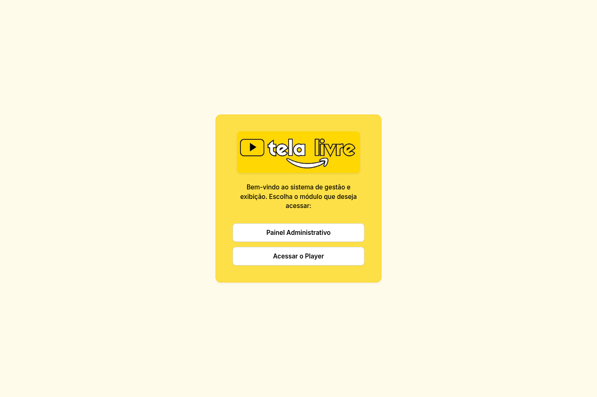

#### tela livre admin
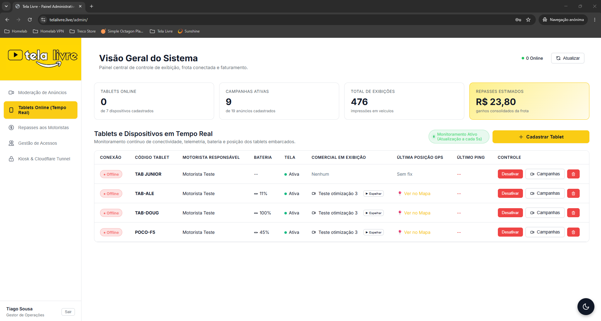

#### tela livre player
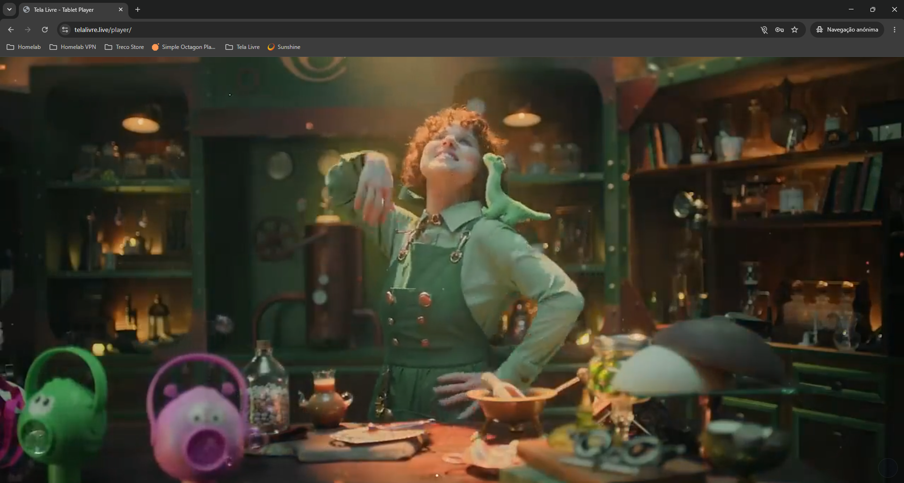

### Problema & Visão de Produto

Plataforma comercial Digital Out-Of-Home (DOOH) projetada para tablets Android instalados em carros de aplicativo (Uber/99).

• Operação 100% Offline-First para zonas sem sinal 4G/5G;
• Estabilidade térmica e de memória em tablets de entrada (2GB RAM);
• Comprovação de entrega (Proof-of-Play com GPS e timestamp) para auditoria de anunciantes;
• Cálculo automatizado de repasses via PIX para motoristas parceiros.

### Arquitetura & Engenharia

• Backend em FastAPI com autenticação JWT, RBAC (admin, anunciante, operador, motorista), SQLAlchemy ORM e migrações Alembic;
• Pipeline assíncrono de vídeo (FFmpeg): normaliza uploads para H.264 720p (maxrate 2500k) e remove faixas de áudio (-an), reduzindo o tamanho em ~30%;
• Player Kiosk Offline-First: Service Worker + IndexedDB armazenam os vídeos (Blobs) localmente e sincronizam logs em lote (POST /api/logs/batch);
• Ambientes segregados de Produção (:8000 / DB :5432) e Homologação (:8001 / DB :5433).

### Orquestração de Agentes de IA

• Documento âncora (CONTEXTO_PROJETO_TELAS.md) garantindo contexto arquitetural persistente para os agentes;
• Automação de patches cirúrgicos de UI e analytics (patch_admin.py, patch_analytics_js.py) e testes automatizados de endpoints (test_endpoints.py);
• Validação assistida em homologação antes da promoção para produção.

---

## 02. Painel Pedagógico — Maria do Carmo

**Resumo:** PWA educacional com motor Gemini 2.5 Flash, Structured Outputs em semáforo e ciclo de aprendizado contínuo por feedback humano.

- **Categoria:** `SaaS & Produtos Web`
- **Status:** `Produção (:8002)`
- **Caminho no Servidor:** `/home/tiago2609/Projetos/maria_do_carmo`
- **Tecnologias:** `FastAPI` • `Gemini 2.5 Flash` • `Structured Outputs` • `SQLite WAL` • `PWA`

### Galeria & Evidências Visuais

#### maria do carmo admin
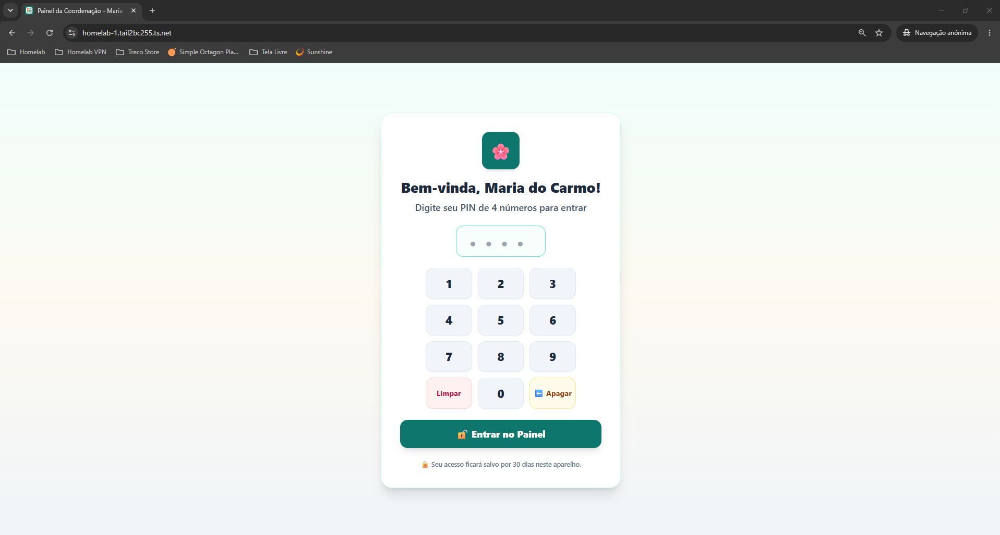

#### maria do carmo redacao
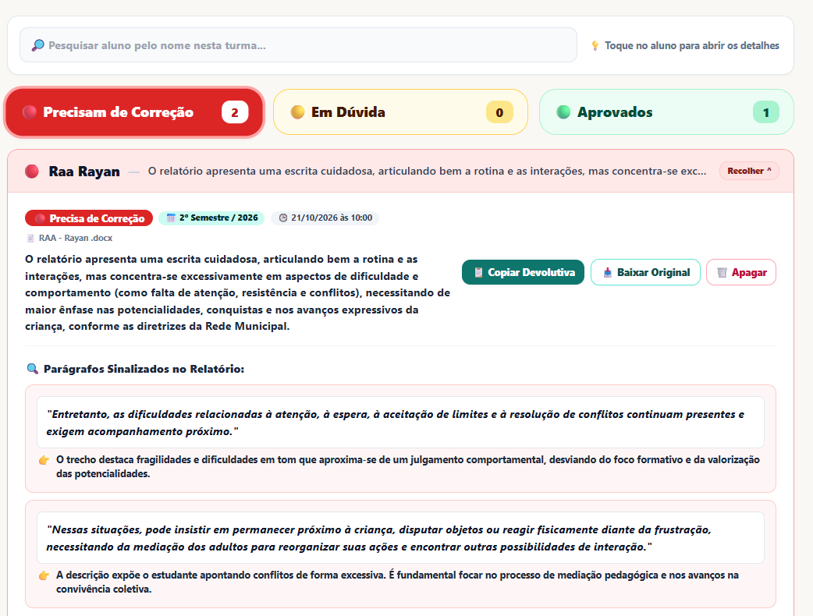

#### maria do carmo devolutiva
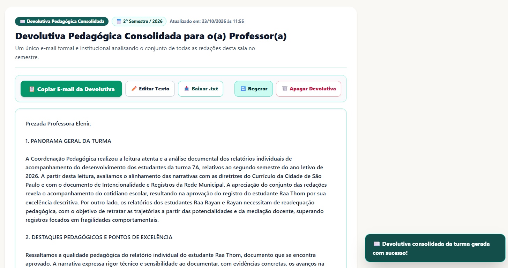

#### maria do carmo base de conhecimento
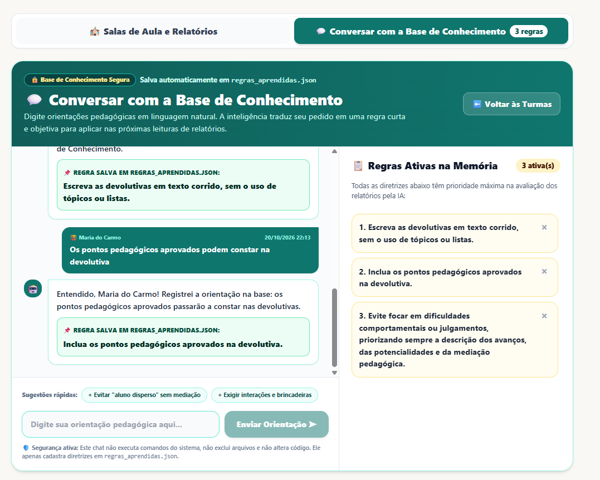

### Problema & Visão de Produto

Desenvolvido sob medida para a coordenadora escolar Maria do Carmo avaliar dezenas de relatórios pedagógicos individuais enviados pelos professores em arquivos .docx, .pdf e .zip.

Substitui horas de revisão manual por uma fila automatizada que classifica cada relatório em Semáforo (🟢 Aprovado, 🟡 Dúvida, 🔴 Incorreto) e já entrega a devolutiva pronta no formato 'De ➡️ Para'.

### Arquitetura & Motor Cognitivo

• Extrator inteligente (extrator.py): lê textos e tabelas de .docx e .pdf, descompacta .zip em memória e separa automaticamente documentos com múltiplos alunos;
• Worker assíncrono em background: processa 1 relatório a cada 6 segundos para respeitar o rate-limit da API sem falhas;
• Avaliador IA (avaliador_ia.py): SDK oficial google-genai (gemini-2.5-flash) com Pydantic Structured Outputs cruzando os relatórios com os PDFs normativos da escola.

### Aprendizado Contínuo & Orquestração IA

• Memória Evolutiva Human-in-the-Loop (regras_aprendidas.json): cada decisão tomada pela coordenadora na aba Amarela (Dúvida) vira regra permanente injetada nos prompts futuros;
• Co-design de UX inclusiva com agentes e geração de guia impresso passo a passo (GUIA_MARIA_DO_CARMO.md).

---

## 03. Gestão Financeira Autônoma PF/PJ

**Resumo:** Plataforma FinTech full-stack em Clean Architecture & DDD com Open Finance (Pluggy), simulador What-If e CFO Copiloto Gemini 3.8.

- **Categoria:** `SaaS & Produtos Web`
- **Status:** `Produção (:8085 / DB :5434)`
- **Caminho no Servidor:** `/home/tiago2609/Projetos/financeiro`
- **Tecnologias:** `TypeScript` • `Clean Arch & DDD` • `Prisma + PG 16` • `React 19` • `Pluggy Open Finance` • `Gemini 3.8 Flash`

### Galeria & Evidências Visuais

#### Dashboard FinTech Dark — Gráficos Donut, Simulador What-If e Copiloto IA (:8085)
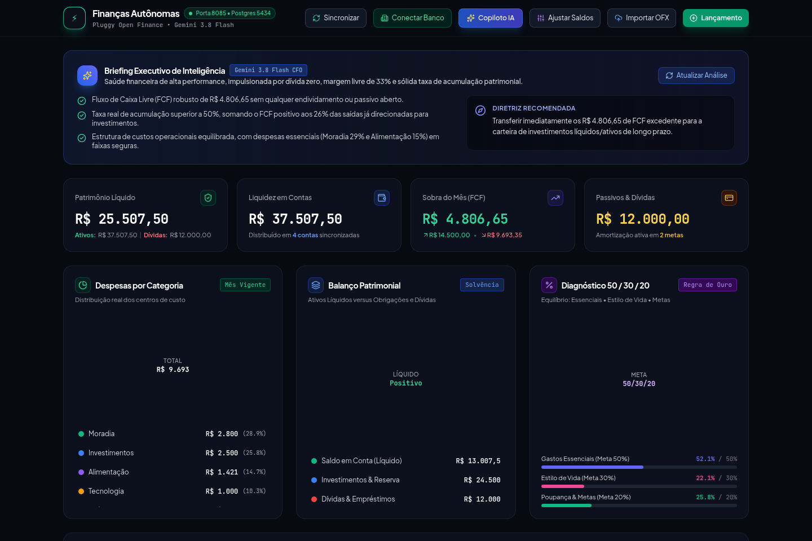

### Problema & Visão de Produto

Sistema financeiro baseado no princípio Zero Manual Data Entry, separando estritamente os contextos Pessoa Física (PF) e Pessoa Jurídica (PJ).

Conecta-se aos bancos via Pluggy Open Finance e listener IMAP, projeta desdobramento de compras parceladas e oferece um simulador interativo de amortização de dívidas e juros compostos (CDI).

### Arquitetura Limpa & Stack

• Backend Node.js/TypeScript estruturado em Clean Architecture e Domain-Driven Design (Workspace, Account, CreditCard, Transaction, Installment, Goal) com Prisma ORM e PostgreSQL 16 (:5434);
• CFO Copiloto IA (Gemini 3.8 Flash): rotas /api/v1/ai/briefing e /api/v1/ai/chat respondendo com base no Fluxo de Caixa Livre (FCF) real;
• Frontend React 19 + Vite + Tailwind + Recharts com 3 gráficos Donut (Categorias, Balanço e Regra 50/30/20) e 3 sliders dinâmicos.

### Orquestração Multi-Agente & Skills

• Desenvolvido utilizando configuração multi-agente (.agents, .claude, .windsurf e skills-lock.json);
• Governado pelo contrato arquitetural PLANO_ARQUITETURA.md, garantindo domínio puro e testável antes do acoplamento de infraestrutura.

---

## 06. Antigravity Telegram Bridge (agy-telegram)

**Resumo:** IDE agêntica remota no Telegram permitindo programar, alternar LLMs, navegar entre repositórios e operar o servidor pelo celular.

- **Categoria:** `Agentes, Memória & AIOps`
- **Status:** `Daemon Ativo (agy-bot.service)`
- **Caminho no Servidor:** `/opt/agy-telegram`
- **Tecnologias:** `Python 3.12` • `Telegram API` • `Antigravity CLI` • `systemd` • `Process Groups`

### Galeria & Evidências Visuais

#### WhatsApp Image 2026-10-23 at 12.03.21
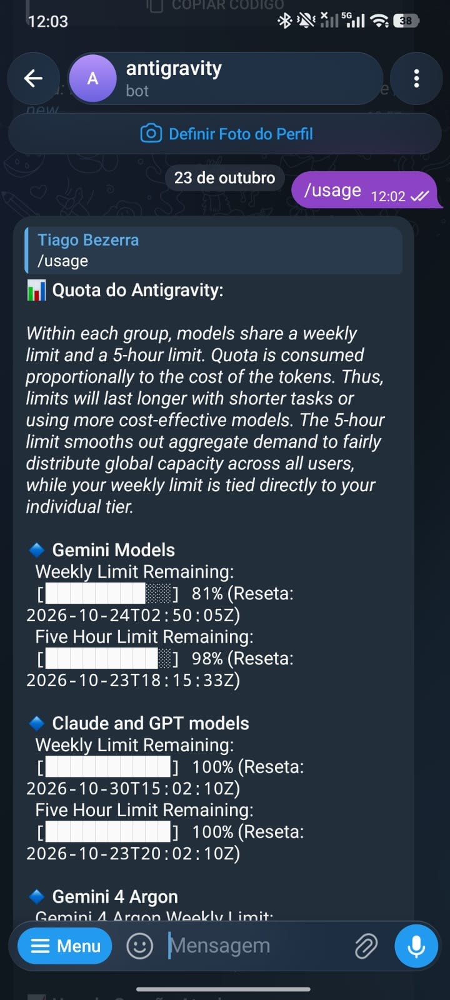

### Problema & Visão de Produto

Permite administrar projetos, corrigir bugs e disparar tarefas complexas de engenharia de software diretamente pelo smartphone via Telegram, sem depender de terminal SSH em um computador.

### Arquitetura & Controles Remotos

• Integração com /usr/local/bin/agy em modo headless (-p, --dangerously-skip-permissions, --output-format json);
• Persistência de sessão (sessions.json) mantendo o conversation_id entre turnos;
• Comandos para troca dinâmica de diretório (/cd, /pwd) e alternância em tempo real de modelos (/model, /effort entre Gemini 3.8 Flash, Claude Sonnet 4.6 e Gemini 3.1 Pro);
• Isolamento de grupo de processos (os.setsid) para cancelamento imediato (/cancel) e sanitizador automático de Markdown.

### Orquestração de Agentes de IA

• O próprio agente diagnosticou as limitações da CLI em modo não-interativo e implementou os 10 aprimoramentos de estabilidade e UX.

---

## 07. Servidor Grafana

**Resumo:** Ambiente de monitoração utilizando Grafana, Prometheus e Kuma

- **Categoria:** `Agentes, Memória & AIOps`
- **Status:** `Estruturado em ai-ops/`
- **Caminho no Servidor:** `/home/tiago2609/homelab-aiops-portfolio/ai-ops`
- **Tecnologias:** `FastMCP` • `Model Context Protocol` • `Python 3.12 Async` • `LiteLLM` • `Open-WebUI`

### Galeria & Evidências Visuais

#### Grafana Docker
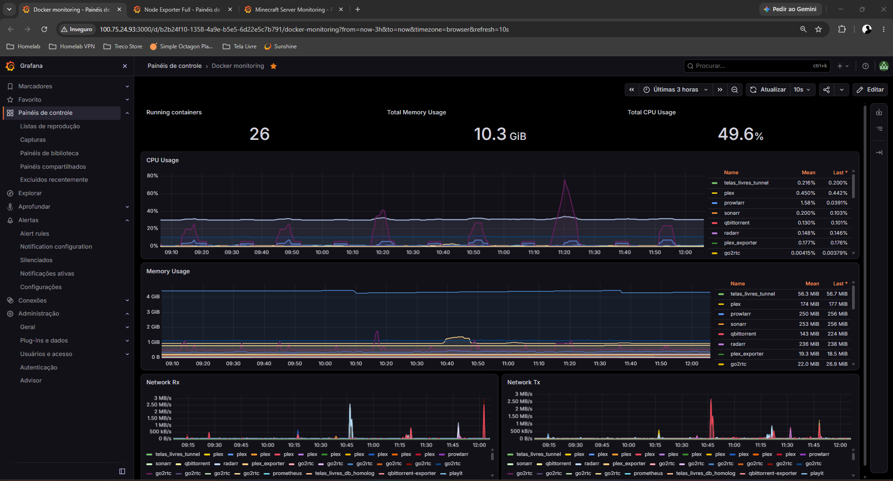

#### Grafana Mine
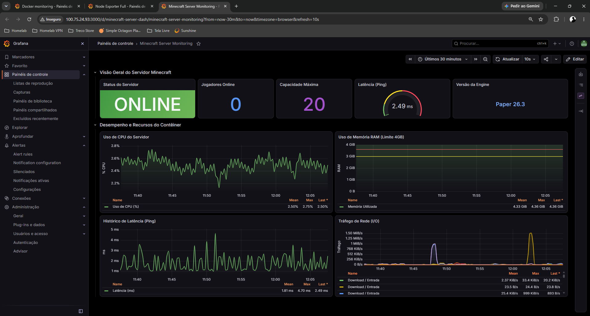

#### Grafana Server
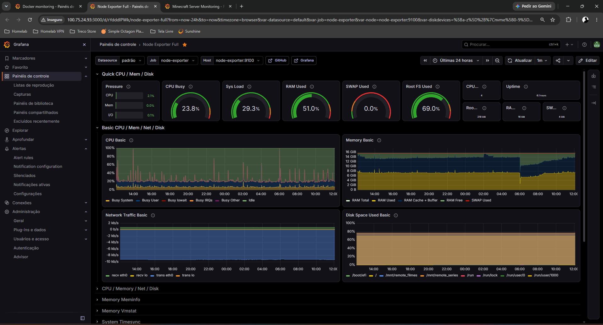

### Problema & Visão AIOps

Permite que agentes de IA inspecionem a saúde real da infraestrutura (métricas PromQL, containers degradados e logs) através do protocolo padronizado MCP da Anthropic, atuando como engenheiros SRE.

### Arquitetura & Segurança

• Servidor FastMCP (mcp_homelab_server.py) expondo tools assíncronas via stdio e SSE;
• LiteLLM AI Gateway (:4000) unificando roteamento de modelos locais e em nuvem com Open-WebUI (:3002);
• Design Read-Only nas ferramentas de diagnóstico para garantir investigações de causa-raiz (RCA) 100% seguras.

---

## 08. Bots de monitoração (Discord & Telegram)

**Resumo:** Bots operacionais integrados ao Docker SDK e psutil com 14 comandos de governança e watchdog preventivo a cada 60 segundos.

- **Categoria:** `Agentes, Memória & AIOps`
- **Status:** `Daemons Ativos 24/7`
- **Caminho no Servidor:** `/home/tiago2609/Projetos/botHomelab`
- **Tecnologias:** `Python 3.12` • `discord.py` • `Docker SDK` • `psutil` • `systemd`

### Galeria & Evidências Visuais

#### Discord
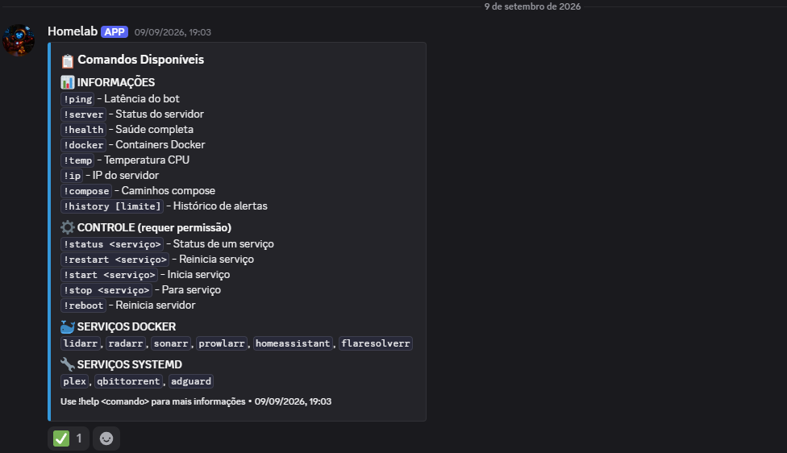

#### Telegram
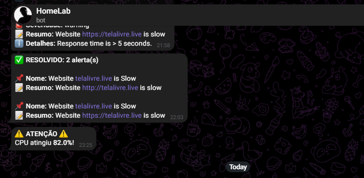

### Problema & Operação Contínua

Monitoramento ativo 24/7 e controle bidirecional dos 26 containers e recursos físicos do servidor (CPU, RAM, disco e temperatura NVMe/ACPI) diretamente pelo Discord e Telegram.

### Arquitetura & Watchdog

• Integração nativa via Docker SDK for Python e psutil sem dependência de comandos shell frágeis;
• Matriz de 14 comandos operacionais com controle de acesso estrito por ID;
• Loop Watchdog assíncrono (60s) que emite alertas preventivos antes que qualquer serviço sofra indisponibilidade.

---

## 09. Automação Trello IA & ERP de Ambientes

**Resumo:** Agente curador de cards/etiquetas com Gemini 3.1 Flash Lite, backup transacional com rollback e provisionamento de funil para móveis planejados.

- **Categoria:** `Automação, 3D & Infra SRE`
- **Status:** `Rotinas & API (:8088) Ativas`
- **Caminho no Servidor:** `/home/tiago2609/Scripts & /opt/trello-api`
- **Tecnologias:** `Python` • `Gemini 3.1 Flash Lite` • `Trello REST API` • `Rollback Transacional` • `FastAPI (:8088)`

### Galeria & Evidências Visuais

#### Trello IA
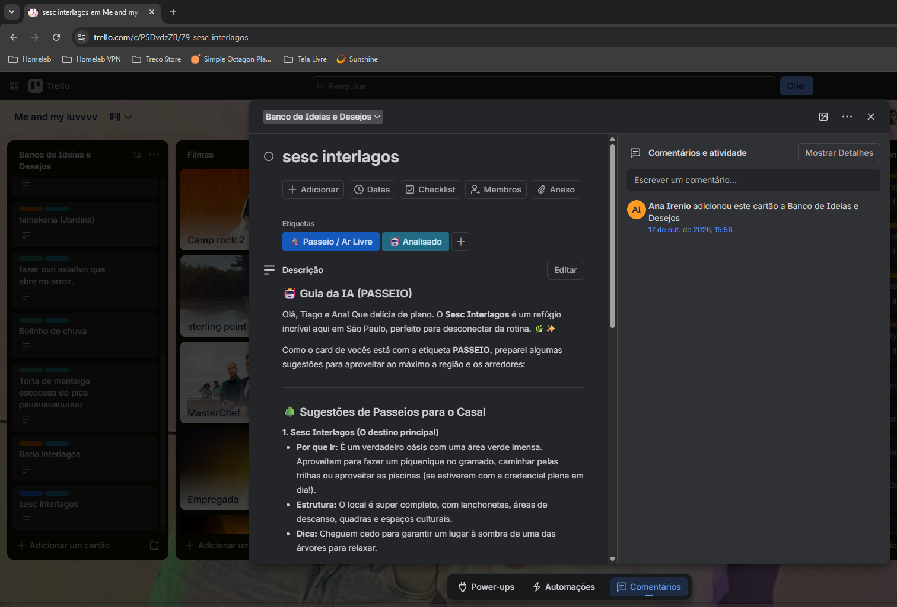

#### Trello Filme
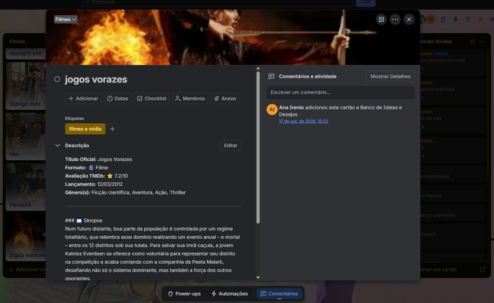

#### Trello etiquetas
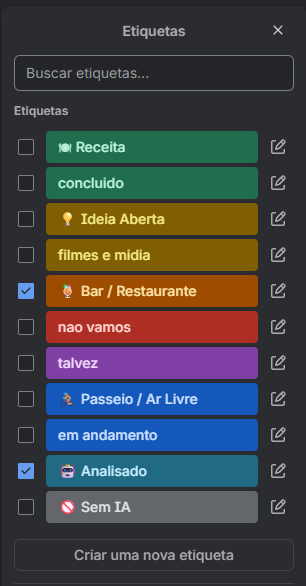

### Problema & Automação de Processos

Combina duas frentes de produtividade sobre a API do Trello:
1. Agente inteligente (auto_ia_desejos.py) que lê etiquetas semânticas e enriquece cards automaticamente com receitas, roteiros ou análises;
2. Estruturação programática de funis comerciais para venda e gestão de ambientes planejados (template_venda_ambientes.py e projeto_ambientes).

### Engenharia de Confiabilidade & Rollback

• Gatilho estrito por etiquetas respeitando travas '🚫 Sem IA' e '🤖 Analisado';
• Snapshot automático pré-mutação em backups_trello_ia/ e histórico auditável (trello_ia_history.json);
• Script dedicado de reversão transacional (rollback_ia_desejos.py) e automação de capas (auto_cover_filmes.py).

---

## 10. Bot de Estudos Microsoft Learn

**Resumo:** Tutor gamificado no Telegram cobrindo 16 módulos e 5 certificações Microsoft Cloud com quizzes nativos e trilha progressiva.

- **Categoria:** `Automação, 3D & Infra SRE`
- **Status:** `Base & Bot Estruturados`
- **Caminho no Servidor:** `/home/tiago2609/Projetos/botEstudos`
- **Tecnologias:** `Python` • `Telegram Quiz Polls` • `Inline Keyboards` • `AZ-900 / SC-900 / MS-900`

### Galeria & Evidências Visuais

#### Bot estudos
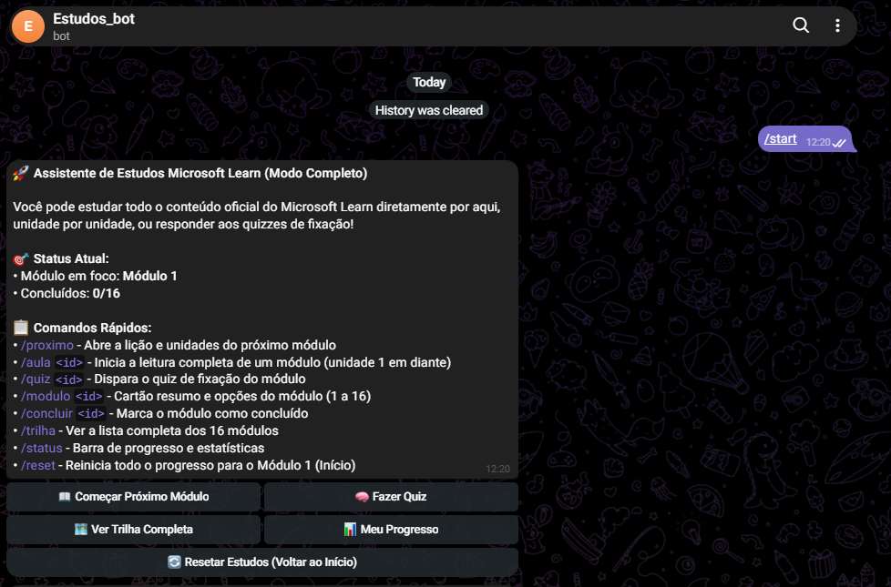

#### Bot estudos quizz
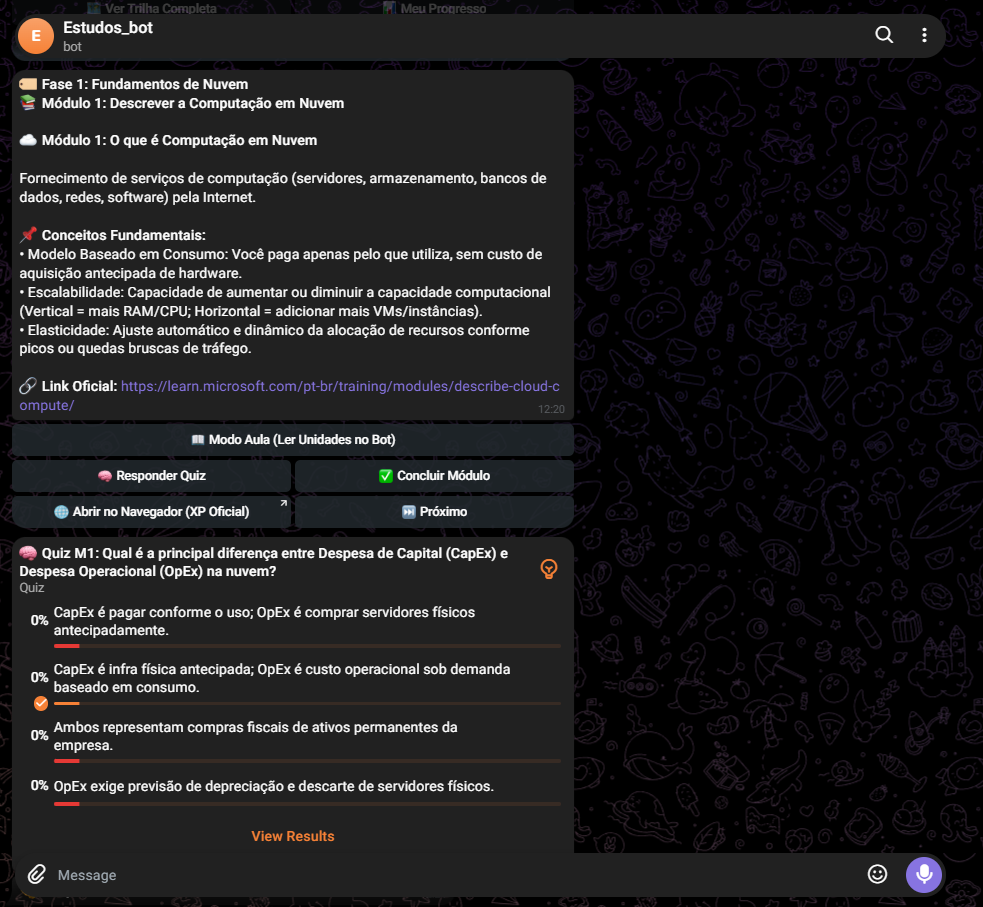

### Problema & Micro-Learning

Transforma o estudo para 5 certificações Microsoft (AZ-900, SC-900, MS-900, MS-700 e MD-102) em sessões rápidas e interativas pelo celular.

### Arquitetura Pedagógica

• 16 módulos divididos em 4 fases progressivas (Nuvem Base ➔ Identidades/Entra ID ➔ Governança M365 ➔ Colaboração & Endpoints);
• Quizzes nativos do Telegram (type='quiz') com correção instantânea e explicação técnica detalhada;
• Curadoria de conteúdo e estruturação de código realizadas em parceria com agentes de IA.

---
